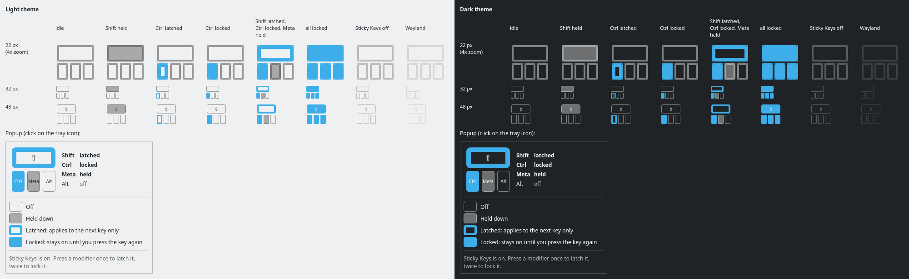

# plasmakey: a Sticky Keys indicator for the Plasma system tray

A small, always-visible icon in the KDE Plasma 6 system tray that shows which
modifier keys **Sticky Keys** has **latched** (one-shot) or **locked**
(persistent), similar to the Windows Sticky Keys indicator. It reads the X
server's real XKB state, updates instantly, and never changes anything: it is a
read-only observer.

Target: **Debian 13, KDE Plasma 6, X11**. Wayland is not supported; there the
icon shows a warning instead of state.



## Reading the icon

The icon is the bottom-left corner of a keyboard: a wide **Shift** key on top,
**Ctrl**, **Meta** (the Windows/Super key) and **Alt** below.

| Key looks like | Meaning |
|---|---|
| faint thin outline | off |
| grey fill | held down |
| **bold** colored outline (hollow) | **latched**: applies to the next key only, then clears |
| **solid** colored fill | **locked**: stays on until you press that key again |

Latched and locked differ by shape (hollow vs. solid), not only color. Hover
for a text summary; click for a popup with the state in words and a legend.
If Sticky Keys is turned off in System Settings, the icon is dimmed.

## Quick start

```sh
make deps        # checks build packages; prints the apt command if any are missing
make             # build into ./build
make test        # unit tests
make install     # per-user install under ~/.local (no root)
make reload      # restart plasmashell so the tray picks it up
```

The icon should now be in the system tray. If it isn't, see
[Show it in the system tray](#show-it-in-the-system-tray).

## Dependencies

Build packages (Debian 13, all from the official archive):

```sh
sudo apt install --no-install-recommends build-essential cmake qt6-base-dev qt6-declarative-dev libxcb-xkb-dev libx11-dev
```

Optional, for the key-tap part of `make test-live`:

```sh
sudo apt install xdotool
```

Running it needs nothing beyond a Plasma 6 X11 desktop (Qt 6, Kirigami,
libxcb-xkb1 are already there). `libx11-dev` is only used by the live test.

## Build, test, install

| Command | What it does |
|---|---|
| `make deps` | check build packages; prints the exact `apt` command if any are missing |
| `make` | configure and build into `./build` (override with `BUILD_DIR=...`) |
| `make test` | unit tests; no X server needed, changes nothing |
| `make test-live` | end-to-end test on the running X server. **Briefly latches/locks modifiers and taps Shift/Ctrl** (never other keys), then restores the original state. Don't type while it runs (~2 s). |
| `make preview` | render the icon in every state (light/dark, 22/32/48 px) and the popup to `build/preview.png`, offscreen |
| `make install` | install for the current user (see below) |
| `make reload` | restart plasmashell so it loads (or, after uninstall, drops) the indicator |
| `make diag` | diagnostic mode: print XKB masks, modifier mapping, Sticky Keys settings, then every state change |
| `make uninstall` | remove everything `make install` added |
| `make clean` | delete `./build` |

`make install` puts files only in your home directory:

| Path | Contents |
|---|---|
| `~/.local/share/plasma/plasmoids/plasmakey/` | the widget (QML + metadata) |
| `~/.local/lib/qml/plasmakey/xkb/` | its small C++ part that reads XKB (a QML module) |
| `~/.local/bin/plasmakey-diag` | diagnostic tool |
| `~/.config/plasma-workspace/env/plasmakey.sh` | adds `~/.local/lib/qml` to `QML_IMPORT_PATH` at login, so plasmashell finds the QML module |

Plasma reads the env file at login. `make reload` applies it to the running
session (via `systemctl --user set-environment`) and restarts plasmashell, so
you don't need to log out. Change the location with `make install PREFIX=...`
(use the same `PREFIX` for `uninstall`).

## Show it in the system tray

After `make install` + `make reload`, Plasma's system tray adds the indicator
automatically. It ships with `EnabledByDefault` and always reports itself
active, so it stays in the visible part of the tray, not the overflow (`^`) menu.

If it doesn't appear, or to make sure it is never hidden:

1. Right-click the tray's `^` arrow (or any empty spot in the tray) → **Configure System Tray…**
2. Open **Entries**.
3. Find **plasmakey** and set it to **Always shown**.
   (If it says **Disabled**, choose **Always shown** to enable it.)

It also works as a regular panel or desktop widget (*Add Widgets…* →
*plasmakey*), but the tray is the intended place.

## Uninstall

```sh
make uninstall   # removes the files listed above
make reload      # drops it from the running panel (or log out and back in)
```

Plasma keeps a harmless entry for the removed item in its tray configuration.
Nothing outside your home directory is touched at any point.

## Troubleshooting

- **Not in the tray after `make reload`**: follow
  [Show it in the system tray](#show-it-in-the-system-tray). Check the
  plasmashell log for errors:
  `journalctl --user -u plasma-plasmashell -b | grep -i plasmakey`
- **Log says `module "plasmakey.xkb" is not installed`**: plasmashell was
  started without `QML_IMPORT_PATH`. Run `make reload`, or log out and back in.
  Check with `systemctl --user show-environment | grep QML_IMPORT_PATH`.
- **The icon shows a warning sign**: hover over it for the reason, e.g. a
  Wayland session (X11 only) or no connection to the X server. It reconnects
  automatically.
- **Alt or Meta looks wrong for your keyboard layout**: run `make diag` (or
  `plasmakey-diag` once installed). It prints which real modifier each key
  maps to and every state change as you press keys. With Sticky Keys on, use
  it as a reference while pressing keys; the icon should always agree with it.
- **Debug logging inside plasmashell**:
  `systemctl --user set-environment QT_LOGGING_RULES='plasmakey.xkb.debug=true'`,
  then `make reload` and watch `journalctl --user -u plasma-plasmashell -f`.
  Turn it off with `systemctl --user unset-environment QT_LOGGING_RULES` and
  `make reload`.
- **`make test-live` says modifiers must be inactive**: release or unlock
  Shift/Ctrl/Alt/Meta first. If it's interrupted, tap the affected modifier to
  clear a latch or lock.

## Environment it was developed and tested on

| Component | Version |
|---|---|
| Debian | 13.7 (trixie), kernel 6.12.113 |
| Session | X11 (`XDG_SESSION_TYPE=x11`), Xorg 21.1.16 |
| Plasma | plasmashell 6.3.6, libplasma 6.3.5 |
| KDE Frameworks | 6.13 |
| Qt | 6.8.2 |
| libxcb-xkb | 1.17.0 |
| Toolchain | CMake 3.31.6, GCC 14.2 |

Test results and the manual checklist: [docs/TESTING.md](docs/TESTING.md).
How it works: [docs/ARCHITECTURE.md](docs/ARCHITECTURE.md).

## Project layout

```
Makefile                 build/install wrapper (run `make help`)
LICENSE.md               BSD 3-Clause license
CMakeLists.txt           top-level CMake
package/                 the plasmoid: metadata.json + contents/ui/*.qml
src/core/                XKB watcher and modifier-mask logic (C++, XCB)
src/qml/                 QML module plasmakey.xkb exposing the state to the plasmoid
src/tools/               plasmakey-diag (diagnostic mode)
tests/                   unit tests, live X11 test, offscreen preview renderer
scripts/                 session helper used by `make install/reload`
docs/                    architecture notes, test checklist and results
```

## License

BSD 3-Clause, see [LICENSE.md](LICENSE.md). Copyright (c) 2026 Lech Gudalewicz.
The widget's About page (in its settings, from the icon's right-click menu) shows the
same copyright and license.
